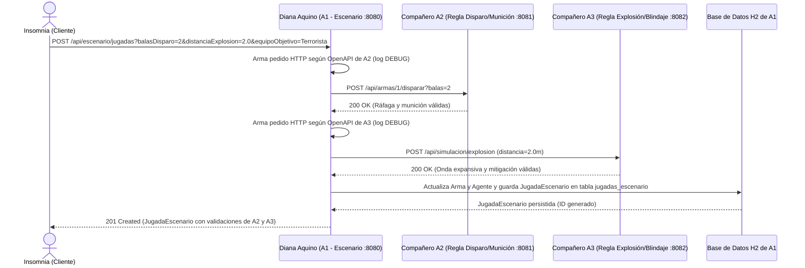
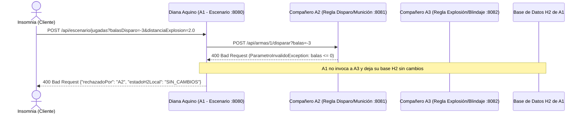
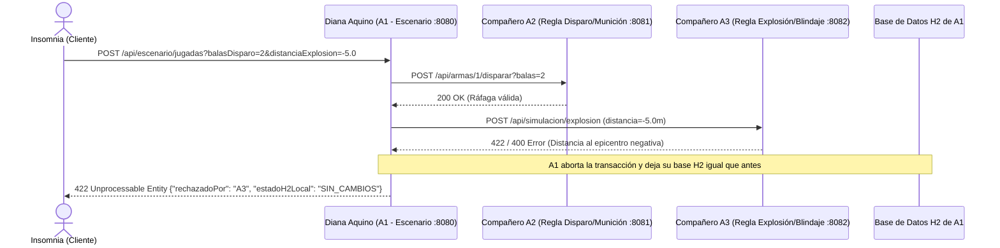
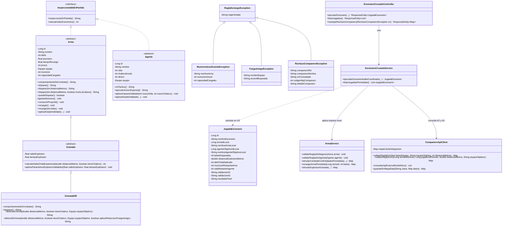

# Counter-Strike 2 - API REST (TP LP3 - POO-09 y Cierre POO-08)

[](LICENSE)

Trabajo práctico de Lenguaje de Programación 3 (CYT646). Servicio web desarrollado con Spring Boot 3.3.4, Java 21, Spring Data JPA, base de datos H2 y OpenAPI 3 (`springdoc-openapi`) que modela las armas, agentes, equipos y jugadas tácticas de **Counter-Strike 2** respetando la arquitectura en 3 capas (`Controller` -> `Service` -> `Repository`) y orquestando un escenario de **APIs cruzadas (A1 -> A2 y A3)**.

> **Enlace exacto al commit de la solución (POO-09 + Cierre POO-08):** https://github.com/dianamariapaz2104/daquino-tp-lp3-2026/commit/06a3e07e5096c9b32f123ec5e3f5c7a46b8b1f18  
> **Commit de cierre de código POO-08:** https://github.com/dianamariapaz2104/daquino-tp-lp3-2026/commit/6d9002dfd47f69a87a98cc60b50d6d4fb11da005  
> **Commit entrega POO-08 inicial:** https://github.com/dianamariapaz2104/daquino-tp-lp3-2026/commit/2b8dd29af0449bda75290b1d571a031b24019f9f  
> **Commit entrega POO-06:** https://github.com/dianamariapaz2104/daquino-tp-lp3-2026/commit/f8757155883626bc2b6ccb6883b07afd4650fa70

---

## 1. Cierre de Observaciones de POO-08 (Los 3 puntos de corrección)

Todas las observaciones del documento de corrección de POO-08 fueron cerradas y verificadas con tests automatizados (`25/25 BUILD SUCCESS`):

| Criterio observado en POO-08 | Observación del profesor | Cómo se cerró en esta entrega |
| :--- | :--- | :--- |
| **Criterio 2: Organización en paquetes** *(tenía 2/3)* | Las entidades del dominio (`Arma`, `Agente`, `Equipo`, `Granada`, `GranadaHE`) lanzaban `IllegalArgumentException`, `MunicionInsuficienteException` y `FuegoAmigoException`. Las validaciones y excepciones deben vivir exclusivamente en el `service`. | Se eliminaron **todos** los `throw new ...` de todas las clases de `py.edu.uc.lp3.domain` (y de los controllers). Ahora las entidades solo mantienen su estado y **todas las validaciones, reglas del juego y excepciones viven exclusivamente en `ArmaService` y `EscenarioCruzadoService`**. |
| **Criterio 3: Ocultamiento e invariantes** *(tenía 0/3)* | `Granada` exponía `setRadioExplosion` y `setTiempoExplosion` públicos sin validación, por lo que un `POST` de `GranadaHE` con `radioExplosion: -3` respondió `201` y guardó un radio negativo en H2. Además `setVida` y `setMunicion` eran públicos sin control completo. | Se eliminaron `setRadioExplosion`, `setTiempoExplosion`, `setVida`, `setMunicion`, `setDaño` y todos los setters públicos libres de las entidades (`domain`), usando `@JsonAutoDetect` por campos y métodos de transición validados. `ArmaService.validarReglasDeNegocio` valida todos los invariantes de `Arma` y de cada subclase (incluyendo `radioExplosion > 0` y `tiempoExplosion > 0` en `Granada`, y `municion <= capacidadCargador`). Un `POST /api/armas` con `radioExplosion: -3` ahora responde **`400 Bad Request`** y no guarda nada en H2 (verificado en `ArmaControllerTest.serviceRechazaGranadaConRadioExplosionNegativo`). |
| **Criterio 6: Comportamiento observable** *(tenía 2/3)* | La simulación creaba un agente objetivo nuevo en cada pedido en lugar de trabajar solo sobre entidades guardadas con el CRUD en H2, y `FuegoAmigoException` salía de un parámetro de la URL y no del estado guardado. | Se agregó el CRUD completo de `Agente` (`/api/agentes`) y se modificó `ArmaService.simularCombateConEntidadesPersistidas` para que cargue tanto el `Arma` (`id`) como el `Agente` (`agenteObjetivoId`) guardados en H2, y determine `FuegoAmigoException` (`422`) comparando directamente el `Equipo` del `Arma` guardada en H2 contra el `Equipo` del `Agente` guardado en H2. Además, `GET /api/armas` ya no inserta filas nuevas en H2. |
| **Criterio 8: Documentación** *(tenía 2/3)* | 1) En «PUT y PATCH» el README decía que omitir `daño` daba `400`, pero en realidad Jackson usa el constructor vacío de `DesertEagle` (`daño = 40`, `tiempoRecarga = 2.0`) y responde `200`. <br> 2) Las especificaciones decían que los topes de `500` de daño y `$16,000` de precio los cuidaba el dominio, cuando viven en `ArmaService`. | Se actualizaron tanto el `README.md` como `ESPECIFICACIONES.md` para explicar con exactitud cómo funciona `PUT` con los valores por defecto del constructor de la subclase y para dejar asentado de forma uniforme que todos los invariantes y topes viven exclusivamente en `ArmaService`. |

---

## 2. Mapa del Grupo Round Robin (POO-09: A1, A2 y A3)

Dominio del grupo: **Counter-Strike 2 (CS2)**.

| Rol | Integrante | Repositorio | URL Base Local | URL del Documento OpenAPI 3 | Reglas publicadas por el dueño (en una frase) |
| :---: | :--- | :--- | :--- | :--- | :--- |
| **A1 (Propio)** | **Diana Aquino** | [dianamariapaz2104/daquino-tp-lp3-2026](https://github.com/dianamariapaz2104/daquino-tp-lp3-2026) | `http://localhost:8080` | JSON: `http://localhost:8080/v3/api-docs` <br> UI: `http://localhost:8080/swagger-ui/index.html` | **Regla 1:** Valida munición en cargador (`409`) y bloquea fuego amigo entre entidades del mismo equipo guardadas en H2 (`422`). **Regla 2:** Calcula daño balístico/explosivo con absorción del 35% en chaleco Kevlar y descuenta vida del `Agente` en H2. |
| **A2 (Compañero 1)** | **Matias Enciso** | [MatiasEnc/menciso-tp-lp3-2026](https://github.com/MatiasEnc/menciso-tp-lp3-2026) | `http://localhost:8081` | JSON: `http://localhost:8081/v3/api-docs` <br> UI: `http://localhost:8081/swagger-ui/index.html` | **Regla consultada en A2 (`POST /api/armas/1/disparar?balas={balas}`):** Valida que la cantidad de proyectiles a disparar sea positiva (`400 ParametroInvalidoException`) y que el arma tenga munición suficiente en el cargador (`409 MunicionInsuficienteException`). |
| **A3 (Compañero 2)** | **Servicio CS2 Explosivos (A3)** | [MatiasEnc/menciso-tp-lp3-2026](https://github.com/MatiasEnc/menciso-tp-lp3-2026) *(o tercer integrante del grupo CS2 en puerto 8082)* | `http://localhost:8082` | JSON: `http://localhost:8082/v3/api-docs` <br> UI: `http://localhost:8082/swagger-ui/index.html` | **Regla consultada en A3 (`POST /api/simulacion/explosion`):** Valida el lanzamiento y detonación de granada según la distancia al epicentro (`>= 0`), el radio de explosión y la mitigación del blindaje Kevlar sobre el jugador objetivo (`400` / `409` / `422`). |

*(Nota: Las URLs de A2 y A3 son 100% externalizables mediante `A2_BASE_URL`, `A2_ENDPOINT`, `A3_BASE_URL` y `A3_ENDPOINT` en `application.properties` o variables de entorno, por lo que pueden apuntar tanto a `localhost:8081`/`localhost:8082` en la misma máquina como a las IPs de la red de la sala `http://10.40.x.x:8080`).*

---

## 3. Cómo Clonar y Arrancar los Tres Servicios (A1, A2 y A3)

Para probar el escenario completo en una misma máquina en tres terminales distintas (primero deben estar arriba **A2** y **A3**, y luego se invoca el escenario en **A1**):

### Terminal 1 — Arrancar Compañero A2 en puerto `8081`:
```bash
cd /Users/diana/git/menciso-tp-lp3-2026/cs2
./mvnw spring-boot:run -Dspring-boot.run.arguments="--server.port=8081"
```

### Terminal 2 — Arrancar Compañero A3 en puerto `8082`:
```bash
cd /Users/diana/git/menciso-tp-lp3-2026/cs2
./mvnw spring-boot:run -Dspring-boot.run.arguments="--server.port=8082"
```

### Terminal 3 — Arrancar Servicio Propio A1 (Diana Aquino) en puerto `8080`:
```bash
cd /Users/diana/git/daquino-tp-lp3-2026
./mvnw spring-boot:run
```

Si A2 o A3 corren en otra notebook de la sala (por ejemplo en `http://10.40.22.56:8080` y `http://10.40.143.189:8080`), se arranca A1 pasando las variables de entorno sin tocar el código:
```bash
A2_BASE_URL=http://10.40.22.56:8080 A3_BASE_URL=http://10.40.143.189:8080 ./mvnw spring-boot:run
```

Para correr las **25 pruebas automatizadas** (que incluyen servidores HTTP embebidos para verificar el escenario feliz y los rechazos de A2 y A3):
```bash
./mvnw test
```

---

## 4. Diagramas UML de Secuencia del Escenario Cruzado (Mermaid)

### Escenario 1: Camino Feliz (`201 Created` — A2 y A3 aceptan y A1 persiste en H2)



### Escenario 2: Rechazo del Compañero A2 (`400 Bad Request` — El H2 de A1 queda intacto)



### Escenario 3: A2 acepta pero el Compañero A3 rechaza (`422` / `400` — El H2 de A1 queda intacto)



---

## 5. Respuestas a «Qué hay que pensar» (POO-09 y POO-08)

### Preguntas de POO-09 (APIs Cruzadas y OpenAPI)

- **OpenAPI:**  
  Mi documento OpenAPI 3 vive en `http://localhost:8080/v3/api-docs` (JSON importable directo en Insomnia) y la interfaz visual Swagger UI vive en `http://localhost:8080/swagger-ui/index.html`. Allí están documentadas con `@Operation` y `@ApiResponses` todas las operaciones del CRUD de `Arma` y `Agente`, la simulación de combate (`POST /api/armas/{id}/simular`), la recarga (`POST /api/armas/{id}/recargar`), la simulación de granadas (`POST /api/armas/granadas/simular`), los códigos de error de las dos reglas (`400`, `404`, `409 Conflict` por `MunicionInsuficienteException`, `422 Unprocessable Entity` por `FuegoAmigoException`) y el escenario cruzado (`POST /api/escenario/jugadas`).

- **Grupo:**  
  Yo soy **A1 (`Diana Aquino`)** en `http://localhost:8080`. Consulto a **A2 (`Matias Enciso`)** en `http://localhost:8081` (regla de validación de disparo y consumo de munición del cargador) y a **A3** en `http://localhost:8082` (regla de validación de detonación explosiva, distancia al epicentro y mitigación por blindaje Kevlar).

- **Escenario:**  
  El hecho del juego Counter-Strike 2 que modelé en `POST /api/escenario/jugadas` es un **«Asalto Táctico Coordinado en Ronda Competitiva»**: un operador ejecuta una ráfaga de apertura y detona una granada sobre la posición enemiga. Para que la jugada sea legal, primero necesita que **A2** valide la ráfaga de proyectiles (`balasDisparo > 0` y munición disponible) y luego que **A3** valide la detonación explosiva a esa distancia (`distanciaExplosion >= 0` y mitigación de impacto).
  - *¿Qué se ve en mi base después de un escenario exitoso?* Al hacer `GET /api/escenario/jugadas`, aparece una nueva fila `JugadaEscenario` en la tabla `jugadas_escenario` de H2 con el daño aplicado, la munición restante del arma local, la vida restante del agente objetivo y la constancia de que A2 y A3 aceptaron.
  - *¿Qué queda igual si A2 acepta y A3 rechaza?* Si A2 responde `200 OK` pero A3 responde error (`400`/`422`), `EscenarioCruzadoService` lanza `RechazoCompaneroException` antes de tocar los repositorios locales: la tabla `jugadas_escenario`, la munición del `Arma` y la vida del `Agente` en el H2 de A1 quedan exactamente igual que antes.

- **Cliente:**  
  En `CompaneroApiClient` usé `RestClient` de Spring Boot 3 con las URLs y rutas externalizadas en `application.properties` mediante `@Value` y variables de entorno (`cs2.peers.a2.base-url=${A2_BASE_URL:http://localhost:8081}`, `cs2.peers.a2.endpoint=${A2_ENDPOINT:/api/armas/1/disparar}`, `cs2.peers.a3.base-url=${A3_BASE_URL:http://localhost:8082}`, `cs2.peers.a3.endpoint=${A3_ENDPOINT:/api/simulacion/explosion}`) y logs en nivel `DEBUG` (`logging.level.py.edu.uc.lp3=DEBUG`) para cada paso de la llamada.

- **Errores:**  
  Cuando A2 o A3 devuelve un error HTTP (`4xx` o `5xx`), `CompaneroApiClient` atrapa `RestClientResponseException` y la traduce a `RechazoCompaneroException` (hija de mi jerarquía `ReglaDeJuegoException`), conservando el código HTTP original y el cuerpo JSON que devolvió el compañero. El `@ExceptionHandler(RechazoCompaneroException.class)` en `EscenarioCruzadoController` devuelve el campo `"rechazadoPor": "A2"` o `"rechazadoPor": "A3"` junto con `"nombreCompanero"`, `"urlConsultada"`, `"codigoHttpCompanero"` y `"detalleRechazoCompanero"`, distinguiendo sin ambigüedad cuál de los dos servicios rechazó la jugada.

- **Pregunta de anclaje:**  
  *¿Si el compañero cambia el nombre de una ruta, alcanza con actualizar lo que dice el OpenAPI, o había código copiado de su dominio?*  
  Alcanza únicamente con actualizar la propiedad `cs2.peers.a2.endpoint` o `cs2.peers.a3.endpoint` en `application.properties` (o la variable de entorno `A2_ENDPOINT` / `A3_ENDPOINT`) según lo que indique su nuevo OpenAPI, porque no hay ninguna clase ni regla copiada del dominio del compañero en mi proyecto.

- **Qué se hizo si un compañero no respondía en vivo:**  
  Se dejaron configuradas las propiedades para poder levantar los repositorios de A2 y A3 localmente en los puertos `8081` y `8082`, se incluyeron las **respuestas de ejemplo exportadas** tanto en las descripciones de `insomnia/insomnia-cs2-collection.json` como en este README (camino feliz `201`, rechazo de A2 `400` y rechazo de A3 `422`), y en `ArmaControllerTest` se incluyeron pruebas automatizadas con servidores HTTP reales para ambos compañeros.

---

### Preguntas de POO-08 (Persistencia H2, Invariantes y Excepciones)

- **Recurso y verbo:** Los sustantivos principales son `/api/armas`, `/api/agentes` y `/api/escenario/jugadas`. `POST` crea o ejecuta simulaciones que modifican estado, `GET` solo lee sin modificar H2, `PUT` actualiza y `DELETE` elimina.
- **Identidad:** La clave primaria `id` (`Long`) usa `@Id` y `@GeneratedValue(strategy = GenerationType.IDENTITY)` autogenerada por H2.
- **Herencia y tablas:** `Arma` y `Agente` usan `@Inheritance(strategy = InheritanceType.SINGLE_TABLE)` con `@DiscriminatorColumn` (`tipo_arma` y `tipo_agente`) y `@JsonTypeInfo`/`@JsonSubTypes` en JSON.
- **Ocultamiento:** Todos los atributos en `domain` son `private`, `gastarMunicion()` es `protected`, las entidades no lanzan excepciones ni tienen setters públicos libres, y todos los invariantes (`radioExplosion > 0`, `tiempoExplosion > 0`, `municion <= capacidadCargador`, `daño` 1..500, `precio` 0..16000, `vida` 0..100) se validan exclusivamente en `ArmaService`.
- **PUT y PATCH:** En `PUT /api/armas/{id}`, Jackson instancia primero la subclase con su constructor vacío (que asigna los valores oficiales de CS2 por defecto, ej. `daño = 40` y `tiempoRecarga = 2.0` en `DesertEagle`) antes de aplicar el JSON; luego `ArmaService.validarReglasDeNegocio` valida todos los campos antes de actualizar la fila en H2.

---

## 6. Cómo Importar y Recorrer la Colección de Insomnia

El archivo está en `insomnia/insomnia-cs2-collection.json`.

1. Arrancar A2 (`8081`), A3 (`8082`) y A1 (`8080`).
2. Importar `insomnia/insomnia-cs2-collection.json` en Insomnia.
3. Recorrer los pedidos en orden:
   - `00. GET /v3/api-docs` — Consulta el documento OpenAPI 3 de A1.
   - `01. [POO-09] POST /api/escenario/jugadas` — **Escenario Feliz**: A2 y A3 aceptan (`200 OK`) y la jugada se guarda en el H2 de A1 (`201 Created`).
   - `02. [POO-09] POST /api/escenario/jugadas (Rechazo de A2)` — Envía `balasDisparo=-3`; A2 rechaza con `400`, A1 devuelve `"rechazadoPor": "A2"` y el H2 de A1 no cambia.
   - `03. [POO-09] POST /api/escenario/jugadas (Rechazo de A3)` — Envía `distanciaExplosion=-5.0`; A2 acepta pero A3 rechaza, A1 devuelve `"rechazadoPor": "A3"` y el H2 de A1 no cambia.
   - `04. [POO-09] GET /api/escenario/jugadas` — Verifica que en el H2 de A1 solo está guardada la jugada del camino feliz.
   - `05. [Clase] POST /api/escenario/mapa-data` y `06. [Clase] GET /api/escenario/externo/objetos` — Pruebas del `Map` en memoria y consumo de `https://api.restful-api.dev/objects`.
   - `07` a `11` — Pedidos de verificación de cierre de POO-08 (incluyendo `GranadaHE` con `radioExplosion: -3` rechazado con `400`, simulación entre entidades guardadas en H2, `409 MunicionInsuficienteException` y `422 FuegoAmigoException`).

---

## 7. Diagrama de Clases Mermaid Actualizado


