# Counter-Strike 2 - API REST (TP LP3 - POO-08)

[](LICENSE)

Trabajo práctico de Lenguaje de Programación 3. Es un servicio web hecho con Spring Boot 3.3.4, Spring Data JPA y base de datos H2 que modela las armas, agentes y equipos del juego Counter-Strike 2 respetando la arquitectura en capas (`Controller` -> `Service` -> `Repository`).

Para armar esto usé herencia, polimorfismo, encapsulamiento, una interfaz de dominio (`InspeccionableEnPartida`), invariantes y una jerarquía de excepciones propias (`ReglaDeJuegoException`, `MunicionInsuficienteException` y `FuegoAmigoException`).

> **Enlace exacto al commit de la solución (POO-08):** https://github.com/dianamariapaz2104/daquino-tp-lp3-2026/commit/db037aed8fcbf7512b2bbc6cf4d135a3d86d5236  
> **Commit anterior (CRUD H2 inicial):** https://github.com/dianamariapaz2104/daquino-tp-lp3-2026/commit/465a7d8726658c6525f6a1041c2ff58f26a11635  
> **Commit de la entrega POO-06:** https://github.com/dianamariapaz2104/daquino-tp-lp3-2026/commit/f8757155883626bc2b6ccb6883b07afd4650fa70

---

## Cómo correrlo

Con Java 21, se puede levantar el proyecto desde la terminal así:

```bash
./mvnw spring-boot:run
```

- Para ver si funciona se entra a `http://localhost:8080/`.
- La consola de la base de datos H2 está en `http://localhost:8080/h2-console` (JDBC URL: `jdbc:h2:file:./data/armas`, usuario: `sa`, contraseña vacía).

Para correr los tests del proyecto:

```bash
./mvnw test
```

---

## Propiedades de H2 en `application.properties`

- **`spring.application.name=cs2`**: Le da el nombre `cs2` a la aplicación en Spring Boot.
- **`spring.datasource.url=jdbc:h2:file:./data/armas`**: Configura H2 para que guarde los datos en el archivo local `./data/armas.mv.db` y no se pierdan al apagar la app.
- **`spring.datasource.driverClassName=org.h2.Driver`**: Indica que se usa el driver JDBC de H2 para conectarse a la base.
- **`spring.datasource.username=sa`**: Define el usuario administrador por defecto de H2 (`sa`).
- **`spring.datasource.password=`**: Deja la contraseña en blanco para el usuario `sa` en desarrollo.
- **`spring.h2.console.enabled=true`**: Activa la consola web en `/h2-console` para poder ver las tablas desde el navegador.
- **`spring.jpa.hibernate.ddl-auto=update`**: Hace que Hibernate cree o actualice las tablas automáticamente según las clases `@Entity` sin borrar los datos ya cargados.
- **`spring.jpa.defer-datasource-initialization=true`**: Espera a que Hibernate arme las tablas antes de correr cualquier carga inicial.
- **`spring.jpa.show-sql=true`**: Muestra en la consola las consultas SQL que se van ejecutando.
- **`spring.jpa.properties.hibernate.format_sql=true`**: Acomoda el SQL en varias líneas en la terminal para que sea más fácil de leer.

---

## Las dos reglas de negocio del juego

En la simulación participan las tres clases principales de mi modelo (`Arma` con sus hijas como `DesertEagle`, `M4A4` y `GranadaHE`; `Agente` con sus hijas `AgenteCT` y `AgenteTerrorista`; y `Equipo`):

1. **Regla 1 (munición, cargador y fuego amigo en `Arma`, `GranadaHE` y `Equipo`):** Un `Arma` solo puede disparar si le quedan balas en el cargador (`municion > 0`) y solo permite recargar cuando no está lleno y las balas son positivas (si no, lanza `MunicionInsuficienteException`), además de bloquear ataques contra un `Agente` del mismo `Equipo` si el fuego amigo está desactivado (lanzando `FuegoAmigoException`).
2. **Regla 2 (daño y absorción de Kevlar en `Arma` y `Agente`):** Cuando el disparo o explosión impacta en un `Agente`, el `Arma` descuenta 1 proyectil, calcula el daño según la distancia y si fue headshot, y el `Agente` absorbe el 35% del golpe en su `chalecoKevlar` antes de restar el daño de su `vida` en H2.

---

## ¿Qué cambió con la sobrecarga y sobreescritura?

**Sobrecarga:**
En `Arma` y en las clases hijas armé 3 constructores sobrecargados: uno vacío (que también sirve para JPA y deja valores válidos por defecto), uno intermedio y otro completo que recibe todos los datos.
También sobrecargué `disparar()` (sin parámetros, con distancia, y con distancia más `tiroALaCabeza`), `recargar()` y `detonarEnArea()`. Así uso el mismo nombre de método con distinta cantidad de parámetros según lo que necesite.

**Sobreescritura (Overriding):**
En la clase abstracta `Arma` declaré `comportamientoDeCombate()` y `disparar()`, y en la clase abstracta `Agente` declaré `rolTactico()` y `ejecutarAccionEspecial()`. Después, en cada clase hija (`M4A4`, `MP9`, `DesertEagle`, `Glock18`, `Nova`, `GranadaHE`, `AgenteCT` y `AgenteTerrorista`) usé `@Override` para darle su comportamiento propio.

---

## Respuestas a «Qué hay que pensar»

**Recurso y verbo:**  
El sustantivo principal de mi API es `/api/armas` (y `/api/agentes`). La URL nombra al recurso y el verbo HTTP dice qué operación se hace: `POST` para crear (`201 Created`), `GET` para leer (`200 OK`), `PUT` para actualizar (`200 OK`) y `DELETE` para borrar (`200 OK`).

**Identidad:**  
La clave primaria es el atributo `id` (`Long`) anotado con `@Id` y `@GeneratedValue(strategy = GenerationType.IDENTITY)`. La asigna directamente la base de datos H2 de forma autoincremental al guardar, así que en el JSON del `POST` no se manda el `id` y el servidor lo devuelve creado.

**Herencia y tablas:**  
Elegí `@Inheritance(strategy = InheritanceType.SINGLE_TABLE)` con la columna discriminadora `tipo_arma` en `Arma` y `tipo_agente` en `Agente`. Lo hice así porque todas las armas comparten casi todos los mismos datos (`daño`, `precision`, `precio`, `municion`, `capacidadCargador`) y es mucho más directo consultarlas en una sola tabla sin cruzar varias tablas con `JOIN`. En el JSON, Jackson distingue de qué subclase se trata usando el campo `"tipoArma"` con `@JsonTypeInfo` y `@JsonSubTypes`.

**Interfaz y repositorio:**  
`ArmaRepository` y `AgenteRepository` son interfaces que extienden `JpaRepository`. Al depender de la interfaz, el servicio y el controller solo llaman a métodos como `save()`, `findById()` o `findAll()` sin importarles cómo se hace el SQL por detrás, igual que pasa con el polimorfismo de las interfaces que vimos en POO-07.

**Protocolo del dominio:**  
Armé la interfaz `InspeccionableEnPartida` en el paquete `domain` con los métodos `inspeccionarEnPartida()` y `calcularValorEconomico()`. La usa el endpoint `GET /api/armas/protocolo`, que junta en una misma lista objetos de dos familias distintas (`Arma` y `Agente`) y los recorre usando solo el tipo de la interfaz.

**Ocultamiento:**  
Las reglas numéricas las cuidan los constructores y los setters de `Arma`, `Agente` y `Equipo` (más el control del tope de `$16,000` en `ArmaService`). El constructor vacío que pide JPA carga valores legales por defecto y los setters validan cada dato antes de asignarlo, para que ni el JSON ni JPA puedan meter valores inválidos. En Insomnia, el pedido `06. POST /api/armas (Ilegal)` manda daño `-10` y munición `-5`, rebota con `400 Bad Request` y al listar con `03. GET /api/armas/todas` se ve que la base no se ensució.

**PUT y PATCH:**  
Usé `PUT /api/armas/{id}`, que reemplaza los campos editables del arma guardada. Si en el JSON del `PUT` se omite un número como `daño`, llega como `0` y el setter lanza error `400 Bad Request` porque viola el invariante de que el daño tiene que ser mayor a cero.

**DELETE:**  
En mi modelo, borrar con `DELETE /api/armas/{id}` significa sacar esa arma del inventario guardado en H2. Primero busca que el `id` exista (si no está devuelve `404 Not Found`) y después la elimina de la tabla.

**Dos reglas:**  
Los dos hechos que cambian el estado de más de un objeto son disparar/detonar validando munición y fuego amigo, y recibir el daño descontando chaleco Kevlar y vida en el agente. El endpoint de la simulación es `POST /api/armas/{id}/simular` (y también `GET /api/armas/granadas/simular`). Cuando corre, le resta 1 bala al `Arma` y le baja `chalecoKevlar` y `vida` al `Agente` en H2; si después hacés un `GET /api/armas/{id}`, se ve que la munición quedó descontada en la base.

**Excepciones:**  
La clase base se llama `ReglaDeJuegoException` y tiene dos hijas con el nombre de cada regla: `MunicionInsuficienteException` (cuando se intenta disparar con `0` balas o recargar mal, devuelve `409 Conflict`) y `FuegoAmigoException` (cuando se ataca a un compañero del mismo equipo con fuego amigo apagado, devuelve `422 Unprocessable Entity`). Un recurso que no existe (`NoSuchElementException` -> `404`) o un dato negativo al construir (`IllegalArgumentException` -> `400`) van por separado. El JSON de error muestra `error`, `tipoExcepcion`, `jerarquiaPadre`, `reglaViolada`, `mensaje` y `estado`. Usé excepciones no comprobadas (`RuntimeException`) para no ensuciar las firmas de los métodos con `throws` y para que Spring haga rollback automático si falla la transacción.

**Preguntas de anclaje:**
- *¿Si mañana cambiamos H2 por otra base, qué archivos tocan y cuáles se quedan quietos?* Solo se tocan el `pom.xml` (para el driver de la nueva base) y `application.properties` (para la URL, usuario y clave). Las clases de `domain`, `repository`, `service` y `controller` quedan intactas.
- *¿Quién lanza la excepción, el controller o el objeto del juego?* La lanza el objeto del juego en el dominio (`Arma` y `GranadaHE`). El controller solo la atrapa con `@ExceptionHandler` y arma la respuesta HTTP.

---

## Cómo importar y recorrer la colección de Insomnia

El archivo está en `insomnia/insomnia-cs2-collection.json`.

1. En Insomnia ir a **Import** y elegir el archivo `insomnia/insomnia-cs2-collection.json`.
2. Elegir el entorno **Base Environment** (`base_url = http://localhost:8080`, `arma_id = 1`).
3. Recorrer los pedidos en orden:
   - `01. GET /` — Verifica que la aplicación responde.
   - `02. POST /api/armas` — Crea una `DesertEagle` en H2 (`201 Created`) con `7` balas. Si devuelve otro `id`, cambiar `arma_id` en el entorno.
   - `03. GET /api/armas/todas` — Muestra la lista de armas guardadas en H2.
   - `04. GET /api/armas/{id}` — Trae el arma creada por su `id`.
   - `05. PUT /api/armas/{id}` — Le actualiza el nombre, daño y precio en H2.
   - `06. POST /api/armas (Ilegal)` — Manda daño `-10` y munición `-5`, da `400 Bad Request` y no guarda basura.
   - `07. GET /api/armas/9999` — Busca un `id` inexistente y da `404 Not Found`.
   - `08. GET /api/armas/protocolo` — Muestra el resultado de usar la interfaz `InspeccionableEnPartida` con armas y agentes.
   - `09. POST /api/armas/{id}/simular` — Simula el combate contra un `Terrorista`, baja la munición de `7` a `6` y le descuenta vida y chaleco al agente. Volviendo a correr el `04. GET /api/armas/{id}` se ve que quedó con `6` balas en H2.
   - `10. POST /api/armas/{id}/recargar?balas=0` — Provoca la excepción hija `MunicionInsuficienteException` (`409 Conflict`).
   - `11. POST /api/armas/{id}/simular (Mismo Equipo)` — Provoca la excepción hija `FuegoAmigoException` (`422 Unprocessable Entity`).
   - `12. DELETE /api/armas/{id}` — Borra el arma de H2 (un `GET` después da `404`).

---

## Diagrama de Clases Mermaid

En el diagrama se distinguen la herencia (`<|--`), la implementación de la interfaz `InspeccionableEnPartida` (`<|..`), el uso de los repositorios (`-->`) y la jerarquía de excepciones (`<|--`):

```mermaid
classDiagram
  class InspeccionableEnPartida {
    <<interface>>
    +inspeccionarEnPartida() String
    +calcularValorEconomico() int
  }

  class Arma {
    <<abstract>>
    -Long id
    -String nombre
    -int daño
    -float precision
    -float tiempoRecarga
    -int precio
    -Equipo equipo
    -int municion
    -int capacidadCargador
    +Arma()
    +Arma(String nombre, int daño, float precision, float tiempoRecarga, int precio, Equipo equipo, int municion)
    +Arma(String nombre, int daño, float precision, float tiempoRecarga, int precio, Equipo equipo, int municion, int capacidadCargador)
    +comportamientoDeCombate() String*
    +disparar() String*
    +inspeccionarEnPartida() String
    +calcularValorEconomico() int
    +disparar(int distanciaMetros) String
    +disparar(int distanciaMetros, boolean tiroALaCabeza) String
    +dispararContraAgente(Agente objetivo, int distanciaMetros, boolean tiroALaCabeza, boolean permitirFuegoAmigo) int
    +cargarMunicionValidada(int balas) int
    +puedeDisparar() boolean
    #gastarMunicion() void
    +recargar() void
    +recargar(int balas) void
    +obtenerInfo() String
  }

  class Equipo {
    -String nombre
    +Equipo()
    +Equipo(String nombre)
    +getNombre() String
    +setNombre(String nombre) void
    +esMismoEquipo(Equipo otro) boolean
    +toString() String
  }

  class Pistola {
    <<abstract>>
    -int capacidadCargadorPistola
    -String modoDisparo
    +Pistola()
    +Pistola(String nombre, int daño, float precision, float tiempoRecarga, int precio, Equipo equipo, int capacidadCargador, String modoDisparo, int municion)
    +Pistola(String nombre, int daño, float precision, float tiempoRecarga, int precio, Equipo equipo, int capacidadCargador, String modoDisparo, int municion, int capacidadCargadorBase)
    +getCapacidadCargadorPistola() int
    +getModoDisparo() String
  }

  class Rifle {
    <<abstract>>
    -String modoDisparo
    -float retroceso
    +Rifle()
    +Rifle(String nombre, int daño, float precision, float tiempoRecarga, int precio, Equipo equipo, String modoDisparo, float retroceso, int municion)
    +Rifle(String nombre, int daño, float precision, float tiempoRecarga, int precio, Equipo equipo, String modoDisparo, float retroceso, int municion, int capacidadCargador)
    +dispararRafaga() void
    +apuntar() void
    +getModoDisparo() String
    +getRetroceso() float
  }

  class Escopeta {
    <<abstract>>
    -int perdigones
    -float dispersion
    +Escopeta()
    +Escopeta(String nombre, int daño, float precision, float tiempoRecarga, int precio, Equipo equipo, int perdigones, float dispersion, int municion)
    +Escopeta(String nombre, int daño, float precision, float tiempoRecarga, int precio, Equipo equipo, int perdigones, float dispersion, int municion, int capacidadCargador)
    +getPerdigones() int
    +getDispersion() float
  }

  class SubfusilSMG {
    <<abstract>>
    -float cadenciaFuego
    -float movilidad
    +SubfusilSMG()
    +SubfusilSMG(String nombre, int daño, float precision, float tiempoRecarga, int precio, Equipo equipo, float cadenciaFuego, float movilidad, int municion)
    +SubfusilSMG(String nombre, int daño, float precision, float tiempoRecarga, int precio, Equipo equipo, float cadenciaFuego, float movilidad, int municion, int capacidadCargador)
    +dispararEnMovimiento() void
    +getCadenciaFuego() float
    +getMovilidad() float
  }

  class Francotirador {
    <<abstract>>
    -float zoom
    -int penetracion
    +Francotirador()
    +Francotirador(String nombre, int daño, float precision, float tiempoRecarga, int precio, Equipo equipo, float zoom, int penetracion, int municion)
    +Francotirador(String nombre, int daño, float precision, float tiempoRecarga, int precio, Equipo equipo, float zoom, int penetracion, int municion, int capacidadCargador)
    +apuntarConMira() void
    +contenerRespiracion() void
    +getZoom() float
    +getPenetracion() int
  }

  class Granada {
    <<abstract>>
    -float radioExplosion
    -float tiempoExplosion
    +Granada()
    +Granada(String nombre, int daño, float precision, float tiempoRecarga, int precio, Equipo equipo, float radioExplosion, float tiempoExplosion, int municion)
    +Granada(String nombre, int daño, float precision, float tiempoRecarga, int precio, Equipo equipo, float radioExplosion, float tiempoExplosion, int municion, int capacidadCargador)
    +lanzar() void
    +rebotar() void
    +calcularDañoOndaExpansiva(double distanciaMetros, boolean tieneChaleco) int
    +getRadioExplosion() float
    +getTiempoExplosion() float
  }

  class DesertEagle {
    +DesertEagle()
    +DesertEagle(Equipo equipo)
    +DesertEagle(int daño, int municion, Equipo equipo)
    +comportamientoDeCombate() String
    +disparar() String
  }

  class Glock18 {
    +Glock18()
    +Glock18(Equipo equipo)
    +Glock18(int daño, int municion, Equipo equipo)
    +comportamientoDeCombate() String
    +disparar() String
  }

  class M4A4 {
    +M4A4()
    +M4A4(Equipo equipo)
    +M4A4(int daño, int municion, Equipo equipo)
    +comportamientoDeCombate() String
    +disparar() String
  }

  class MP9 {
    +MP9()
    +MP9(Equipo equipo)
    +MP9(int daño, int municion, Equipo equipo)
    +comportamientoDeCombate() String
    +disparar() String
  }

  class Nova {
    +Nova()
    +Nova(Equipo equipo)
    +Nova(int daño, int municion, Equipo equipo)
    +comportamientoDeCombate() String
    +disparar() String
  }

  class GranadaHE {
    +GranadaHE()
    +GranadaHE(Equipo equipo)
    +GranadaHE(int daño, int municion, Equipo equipo)
    +comportamientoDeCombate() String
    +disparar() String
    +detonarEnArea(double distanciaMetros, boolean tieneChaleco, Equipo equipoObjetivo) String
    +detonarEnArea(double distanciaMetros, boolean tieneChaleco, Equipo equipoObjetivo, boolean permitirFuegoAmigo) String
  }

  class Agente {
    <<abstract>>
    -Long id
    -String nombre
    -int vida
    -int chalecoKevlar
    -int dinero
    -Equipo equipo
    +Agente()
    +Agente(String nombre, Equipo equipo)
    +Agente(String nombre, int vida, int chalecoKevlar, int dinero, Equipo equipo)
    +rolTactico() String*
    +ejecutarAccionEspecial() String*
    +inspeccionarEnPartida() String
    +calcularValorEconomico() int
    +tieneChaleco() boolean
    +estaVivo() boolean
    +recibirDañoExplosivo(int dañoFinal) void
  }

  class AgenteCT {
    -boolean tieneKitDesactivacion
    +AgenteCT()
    +AgenteCT(String nombre, boolean tieneKitDesactivacion)
    +AgenteCT(String nombre, int vida, int chalecoKevlar, int dinero, boolean tieneKitDesactivacion)
    +rolTactico() String
    +ejecutarAccionEspecial() String
    +isTieneKitDesactivacion() boolean
    +setTieneKitDesactivacion(boolean tieneKitDesactivacion) void
  }

  class AgenteTerrorista {
    -boolean portaBombaC4
    +AgenteTerrorista()
    +AgenteTerrorista(String nombre, boolean portaBombaC4)
    +AgenteTerrorista(String nombre, int vida, int chalecoKevlar, int dinero, boolean portaBombaC4)
    +rolTactico() String
    +ejecutarAccionEspecial() String
    +isPortaBombaC4() boolean
    +setPortaBombaC4(boolean portaBombaC4) void
  }

  class ReglaDeJuegoException {
    -String reglaViolada
    +ReglaDeJuegoException(String reglaViolada, String mensaje)
    +getReglaViolada() String
  }

  class MunicionInsuficienteException {
    -String nombreArma
    -int municionActual
    -int capacidadCargador
    +MunicionInsuficienteException(String nombreArma, int municionActual, int capacidadCargador, String mensaje)
    +getNombreArma() String
    +getMunicionActual() int
    +getCapacidadCargador() int
  }

  class FuegoAmigoException {
    -String nombreEquipo
    -String accionBloqueada
    +FuegoAmigoException(String nombreEquipo, String accionBloqueada, String mensaje)
    +getNombreEquipo() String
    +getAccionBloqueada() String
  }

  class ArmaRepository {
    <<interface>>
    +findByNombreIgnoreCase(String nombre) Optional~Arma~
    +existsByNombreIgnoreCase(String nombre) boolean
    +findByEquipo_NombreIgnoreCase(String nombreEquipo) List~Arma~
  }

  class AgenteRepository {
    <<interface>>
    +findByNombreIgnoreCase(String nombre) Optional~Agente~
    +findByEquipo_NombreIgnoreCase(String nombreEquipo) List~Agente~
  }

  class ArmaService {
    -ArmaRepository armaRepository
    -AgenteRepository agenteRepository
    +ArmaService(ArmaRepository armaRepository, AgenteRepository agenteRepository)
    +crearArma(Arma arma) Arma
    +listarTodas() List~Arma~
    +obtenerPorId(Long id) Arma
    +actualizarArma(Long id, Arma datosActualizados) Arma
    +eliminarArma(Long id) void
    +listarAgentes() List~Agente~
    +obtenerAgentePorId(Long id) Agente
    +validarReglasDeNegocio(Arma arma) void
    +simularCombateConArmaPersistida(Long armaId, String equipoObjetivoNombre, int distanciaMetros, boolean tiroALaCabeza, boolean tieneChalecoKevlar, boolean permitirFuegoAmigo) Map
    +recargarArmaPersistida(Long armaId, int balas) Map
    +simularExplosionGranada(String equipoAtacanteNombre, String equipoObjetivoNombre, double distanciaMetros, boolean tieneChalecoKevlar, boolean permitirFuegoAmigo, int dañoBase) Map
    +obtenerElementosProtocolo() List~InspeccionableEnPartida~
    +obtenerAgentesPolimorfismo() List~Agente~
    +construirYGuardarArma(String nombre, Integer daño, Integer municion, String equipoNombre) Arma
    +obtenerCatalogoPolimorfico() List~Arma~
    +fabricarArma(String nombre, Integer daño, Integer municion, Equipo equipo) Arma
  }

  class ArmaController {
    -ArmaService armaService
    +ArmaController(ArmaService armaService)
    +crearArma(Arma arma) ResponseEntity~Arma~
    +listarTodas() ResponseEntity~List~
    +obtenerPorId(Long id) ResponseEntity~Arma~
    +actualizarArma(Long id, Arma armaActualizada) ResponseEntity~Arma~
    +eliminarArma(Long id) ResponseEntity~Map~
    +consultarProtocoloInspeccionable() ResponseEntity~List~
    +simularCombatePost(Long id, String equipoObjetivo, int distancia, boolean headshot, boolean chaleco, boolean fuegoAmigo) ResponseEntity~Map~
    +simularCombateGet(Long id, String equipoObjetivo, int distancia, boolean headshot, boolean chaleco, boolean fuegoAmigo) ResponseEntity~Map~
    +recargarArmaPersistida(Long id, int balas) ResponseEntity~Map~
    +listarAgentesPersistidos() ResponseEntity~List~
    +obtenerAgentePorId(Long id) ResponseEntity~Agente~
    +construirArma(String nombre, Integer municion, Integer daño, String equipoNombre) Map
    +demostrarPolimorfismo() List~Map~
    +dispararArma(String nombre, Integer distancia, boolean headshot) Map
    +simularExplosionGranada(String equipoAtacante, String equipoObjetivo, double distancia, boolean chaleco, boolean fuegoAmigo, int dañoBase) ResponseEntity~Map~
    +demostrarPolimorfismoAgentes() List~Map~
    +manejarMunicionInsuficiente(MunicionInsuficienteException ex) ResponseEntity~Map~
    +manejarFuegoAmigo(FuegoAmigoException ex) ResponseEntity~Map~
    +manejarReglaDeJuegoBase(ReglaDeJuegoException ex) ResponseEntity~Map~
    +manejarReglaViolada(IllegalArgumentException ex) ResponseEntity~Map~
    +manejarNoEncontrado(NoSuchElementException ex) ResponseEntity~Map~
  }

  InspeccionableEnPartida <|.. Arma
  InspeccionableEnPartida <|.. Agente

  Arma <|-- Pistola
  Arma <|-- Rifle
  Arma <|-- Escopeta
  Arma <|-- SubfusilSMG
  Arma <|-- Francotirador
  Arma <|-- Granada

  Pistola <|-- DesertEagle
  Pistola <|-- Glock18
  Rifle <|-- M4A4
  SubfusilSMG <|-- MP9
  Escopeta <|-- Nova
  Granada <|-- GranadaHE

  Agente <|-- AgenteCT
  Agente <|-- AgenteTerrorista

  Arma --> Equipo : equipo
  Agente --> Equipo : equipo

  ReglaDeJuegoException <|-- MunicionInsuficienteException
  ReglaDeJuegoException <|-- FuegoAmigoException

  ArmaController --> ArmaService : usa
  ArmaService --> ArmaRepository : usa
  ArmaService --> AgenteRepository : usa
  ArmaRepository ..> Arma : gestiona
  AgenteRepository ..> Agente : gestiona
  ArmaController ..> MunicionInsuficienteException : maneja (409)
  ArmaController ..> FuegoAmigoException : maneja (422)
```


