# Counter-Strike 2 - API REST (TP LP3)

[](LICENSE)

Trabajo práctico de Lenguaje de Programación 3. Es un servicio web hecho con Spring Boot 3.3.4, Spring Data JPA y base de datos H2 que modela las armas y agentes del juego Counter-Strike 2 respetando la arquitectura de 3 capas (`Controller` -> `Service` -> `Repository`).

Para armar esto usé herencia, polimorfismo, encapsulamiento e invariantes de dominio. Cuenta con dos jerarquías de clases:
1. La clase abstracta `Arma` de la que heredan las familias (`Pistola`, `Rifle`, `Escopeta`, `SubfusilSMG`, `Francotirador`, `Granada`) y las armas concretas (`DesertEagle`, `Glock18`, `M4A4`, `MP9`, `Nova`, `GranadaHE`).
2. La clase abstracta `Agente` de la que heredan `AgenteCT` y `AgenteTerrorista`.

> **Commit exacto de la entrega actual (CRUD H2 + 3 Capas + Simulación Explosivos):** https://github.com/dianamariapaz2104/daquino-tp-lp3-2026/commit/058c8521c384223c4d7a5f41f01d557dccc11899  
> **Commit exacto de la entrega POO-06:** https://github.com/dianamariapaz2104/daquino-tp-lp3-2026/commit/f8757155883626bc2b6ccb6883b07afd4650fa70

## Cómo correrlo
Con Java 21, se puede levantar el proyecto desde la terminal así:
```bash
./mvnw spring-boot:run
```
Para ver si funciona se entra a `http://localhost:8080/`.  
La consola de la base de datos H2 está disponible en `http://localhost:8080/h2-console` (JDBC URL: `jdbc:h2:file:./data/armas`, usuario: `sa`, contraseña vacía).

Para correr los 16 tests automatizados del proyecto:
```bash
./mvnw test
```

## ¿Qué cambió con la sobrecarga y sobreescritura?

**Sobrecarga:**
En la clase `Arma` y en las clases hijas armé 3 constructores sobrecargados: uno vacío, uno intermedio y otro completo que recibe todos los datos (`nombre, daño, precision, tiempoRecarga, precio, equipo, municion, capacidadCargador`).
También sobrecargué los métodos `disparar()` y `recargar()`. Dependiendo de si le paso o no la distancia y `tiroALaCabeza` por parámetro, ejecuta distintas variantes del cálculo balístico. En vez de tener un único constructor gigante o inventar nombres como `dispararBasico()` o `dispararConDistancia()`, uso siempre el mismo nombre de método con distinta firma.

**Sobreescritura (Overriding):**
En mi clase abstracta `Arma` declaré los métodos abstractos `comportamientoDeCombate()` y `disparar()`, y en la clase abstracta `Agente` declaré `rolTactico()` y `ejecutarAccionEspecial()`. Después, en cada clase concreta (`M4A4`, `MP9`, `DesertEagle`, `Glock18`, `Nova`, `GranadaHE`, `AgenteCT`, `AgenteTerrorista`) les puse `@Override` y les di su comportamiento específico. Así cuando llamo al método desde el servicio o controller sobre una lista `List<Arma>` o `List<Agente>`, gracias al polimorfismo responde cada subclase sin usar `instanceof`.

## Endpoints

### CRUD REST en 3 Capas (`ArmaController` -> `ArmaService` -> `ArmaRepository` + H2)
- **`POST /api/armas`** Valida las reglas de negocio en `ArmaService` (ej. presupuesto máximo de CS2 de `$16,000`) y persiste un arma en H2 (`201 Created`).
- **`GET /api/armas/todas`** Lista todas las armas almacenadas en la base de datos H2.
- **`GET /api/armas/{id}`** Obtiene un arma por su ID desde H2 (`200 OK` o `404 Not Found`).
- **`PUT /api/armas/{id}`** Valida y actualiza un arma existente en H2.
- **`DELETE /api/armas/{id}`** Elimina un arma de H2 por su ID.

### Regla de Negocio y Polimorfismo del Dominio
- **`GET /`** Devuelve la autora, el dominio y el catálogo de endpoints disponibles.
- **`GET /api/armas?nombre=M4A4&municion=25&daño=32&equipo=Counter-Terrorista`** Construye el arma desde parámetros de la URL usando los constructores sobrecargados, la persiste en H2 y devuelve el JSON. Si recibe valores ilegales (ej. munición negativa) devuelve `400 Bad Request`.
- **`GET /api/armas/polimorfismo`** Muestra una lista polimórfica `List<Arma>` con el mensaje propio de `M4A4`, `MP9`, `DesertEagle`, `Glock18`, `Nova` y `GranadaHE`.
- **`GET /api/agentes/polimorfismo`** Muestra una lista polimórfica `List<Agente>` con el rol táctico y acción especial de `AgenteCT` y `AgenteTerrorista`.
- **`GET /api/armas/disparar?nombre=M4A4&distancia=30&headshot=true`** Demuestra las sobrecargas del método `disparar`.
- **`GET /api/armas/granadas/simular?equipoAtacante=Counter-Terrorista&equipoObjetivo=Terrorista&distancia=2.0&chaleco=true`** Simulación de explosivos donde participan 3 clases del modelo (`Agente`, `GranadaHE`/`Granada` y `Equipo`), validando fuego amigo, radio de explosión (`5.0m`), absorción de chaleco Kevlar y descuento de vida en H2.

## Diagrama de Clases
Este diagrama coincide exactamente con las clases, constructores, atributos y métodos en `src/main/java/py/edu/uc/lp3/domain`:

```mermaid
classDiagram
  class Arma {
    <<abstract>>
    -Long id
    -String nombre
    -int daño
    -float precision
    -float tiempoRecarga
    -int precio
    -Equipo equipo
    -int municion
    -int capacidadCargador
    +Arma()
    +Arma(String nombre, int daño, float precision, float tiempoRecarga, int precio, Equipo equipo, int municion)
    +Arma(String nombre, int daño, float precision, float tiempoRecarga, int precio, Equipo equipo, int municion, int capacidadCargador)
    +comportamientoDeCombate() String*
    +disparar() String*
    +disparar(int distanciaMetros) String
    +disparar(int distanciaMetros, boolean tiroALaCabeza) String
    +puedeDisparar() boolean
    #gastarMunicion() void
    +recargar() void
    +recargar(int balas) void
    +obtenerInfo() String
  }

  class Equipo {
    -String nombre
    +Equipo()
    +Equipo(String nombre)
    +getNombre() String
    +setNombre(String nombre) void
    +esMismoEquipo(Equipo otro) boolean
    +toString() String
  }

  class Pistola {
    <<abstract>>
    -int capacidadCargadorPistola
    -String modoDisparo
    +Pistola()
    +Pistola(String nombre, int daño, float precision, float tiempoRecarga, int precio, Equipo equipo, int capacidadCargador, String modoDisparo, int municion)
    +Pistola(String nombre, int daño, float precision, float tiempoRecarga, int precio, Equipo equipo, int capacidadCargador, String modoDisparo, int municion, int capacidadCargadorBase)
    +getCapacidadCargadorPistola() int
    +getModoDisparo() String
  }

  class Rifle {
    <<abstract>>
    -String modoDisparo
    -float retroceso
    +Rifle()
    +Rifle(String nombre, int daño, float precision, float tiempoRecarga, int precio, Equipo equipo, String modoDisparo, float retroceso, int municion)
    +Rifle(String nombre, int daño, float precision, float tiempoRecarga, int precio, Equipo equipo, String modoDisparo, float retroceso, int municion, int capacidadCargador)
    +dispararRafaga() void
    +apuntar() void
    +getModoDisparo() String
    +getRetroceso() float
  }

  class Escopeta {
    <<abstract>>
    -int perdigones
    -float dispersion
    +Escopeta()
    +Escopeta(String nombre, int daño, float precision, float tiempoRecarga, int precio, Equipo equipo, int perdigones, float dispersion, int municion)
    +Escopeta(String nombre, int daño, float precision, float tiempoRecarga, int precio, Equipo equipo, int perdigones, float dispersion, int municion, int capacidadCargador)
    +getPerdigones() int
    +getDispersion() float
  }

  class SubfusilSMG {
    <<abstract>>
    -float cadenciaFuego
    -float movilidad
    +SubfusilSMG()
    +SubfusilSMG(String nombre, int daño, float precision, float tiempoRecarga, int precio, Equipo equipo, float cadenciaFuego, float movilidad, int municion)
    +SubfusilSMG(String nombre, int daño, float precision, float tiempoRecarga, int precio, Equipo equipo, float cadenciaFuego, float movilidad, int municion, int capacidadCargador)
    +dispararEnMovimiento() void
    +getCadenciaFuego() float
    +getMovilidad() float
  }

  class Francotirador {
    <<abstract>>
    -float zoom
    -int penetracion
    +Francotirador()
    +Francotirador(String nombre, int daño, float precision, float tiempoRecarga, int precio, Equipo equipo, float zoom, int penetracion, int municion)
    +Francotirador(String nombre, int daño, float precision, float tiempoRecarga, int precio, Equipo equipo, float zoom, int penetracion, int municion, int capacidadCargador)
    +apuntarConMira() void
    +contenerRespiracion() void
    +getZoom() float
    +getPenetracion() int
  }

  class Granada {
    <<abstract>>
    -float radioExplosion
    -float tiempoExplosion
    +Granada()
    +Granada(String nombre, int daño, float precision, float tiempoRecarga, int precio, Equipo equipo, float radioExplosion, float tiempoExplosion, int municion)
    +Granada(String nombre, int daño, float precision, float tiempoRecarga, int precio, Equipo equipo, float radioExplosion, float tiempoExplosion, int municion, int capacidadCargador)
    +lanzar() void
    +rebotar() void
    +calcularDañoOndaExpansiva(double distanciaMetros, boolean tieneChaleco) int
    +getRadioExplosion() float
    +getTiempoExplosion() float
  }

  class DesertEagle {
    +DesertEagle()
    +DesertEagle(Equipo equipo)
    +DesertEagle(int daño, int municion, Equipo equipo)
    +comportamientoDeCombate() String
    +disparar() String
  }

  class Glock18 {
    +Glock18()
    +Glock18(Equipo equipo)
    +Glock18(int daño, int municion, Equipo equipo)
    +comportamientoDeCombate() String
    +disparar() String
  }

  class M4A4 {
    +M4A4()
    +M4A4(Equipo equipo)
    +M4A4(int daño, int municion, Equipo equipo)
    +comportamientoDeCombate() String
    +disparar() String
  }

  class MP9 {
    +MP9()
    +MP9(Equipo equipo)
    +MP9(int daño, int municion, Equipo equipo)
    +comportamientoDeCombate() String
    +disparar() String
  }

  class Nova {
    +Nova()
    +Nova(Equipo equipo)
    +Nova(int daño, int municion, Equipo equipo)
    +comportamientoDeCombate() String
    +disparar() String
  }

  class GranadaHE {
    +GranadaHE()
    +GranadaHE(Equipo equipo)
    +GranadaHE(int daño, int municion, Equipo equipo)
    +comportamientoDeCombate() String
    +disparar() String
    +detonarEnArea(double distanciaMetros, boolean tieneChaleco, Equipo equipoObjetivo) String
  }

  class Agente {
    <<abstract>>
    -Long id
    -String nombre
    -int vida
    -int chalecoKevlar
    -int dinero
    -Equipo equipo
    +Agente()
    +Agente(String nombre, Equipo equipo)
    +Agente(String nombre, int vida, int chalecoKevlar, int dinero, Equipo equipo)
    +rolTactico() String*
    +ejecutarAccionEspecial() String*
    +tieneChaleco() boolean
    +estaVivo() boolean
    +recibirDañoExplosivo(int dañoFinal) void
  }

  class AgenteCT {
    -boolean tieneKitDesactivacion
    +AgenteCT()
    +AgenteCT(String nombre, boolean tieneKitDesactivacion)
    +AgenteCT(String nombre, int vida, int chalecoKevlar, int dinero, boolean tieneKitDesactivacion)
    +rolTactico() String
    +ejecutarAccionEspecial() String
  }

  class AgenteTerrorista {
    -boolean portaBombaC4
    +AgenteTerrorista()
    +AgenteTerrorista(String nombre, boolean portaBombaC4)
    +AgenteTerrorista(String nombre, int vida, int chalecoKevlar, int dinero, boolean portaBombaC4)
    +rolTactico() String
    +ejecutarAccionEspecial() String
  }

  Arma <|-- Pistola
  Arma <|-- Rifle
  Arma <|-- Escopeta
  Arma <|-- SubfusilSMG
  Arma <|-- Francotirador
  Arma <|-- Granada

  Pistola <|-- DesertEagle
  Pistola <|-- Glock18
  Rifle <|-- M4A4
  SubfusilSMG <|-- MP9
  Escopeta <|-- Nova
  Granada <|-- GranadaHE

  Agente <|-- AgenteCT
  Agente <|-- AgenteTerrorista

  Arma --> Equipo : equipo
  Agente --> Equipo : equipo
```


